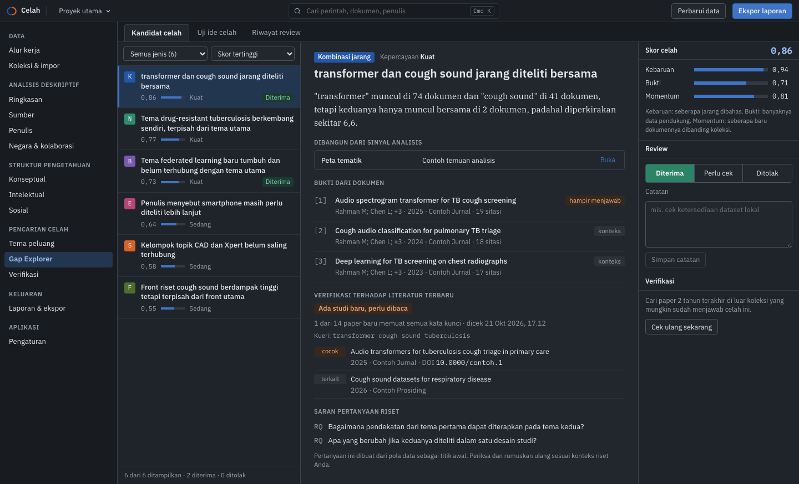
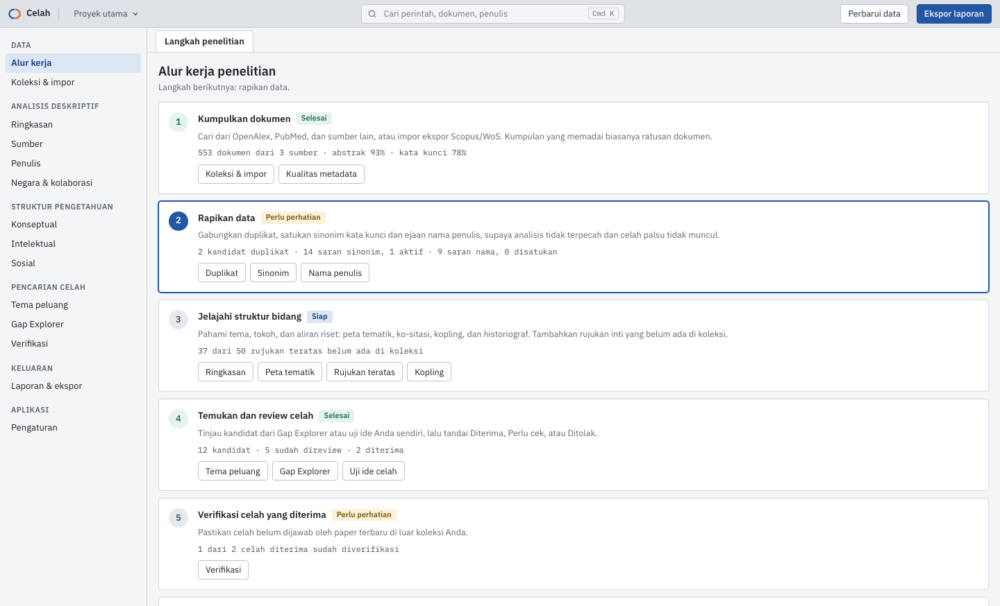
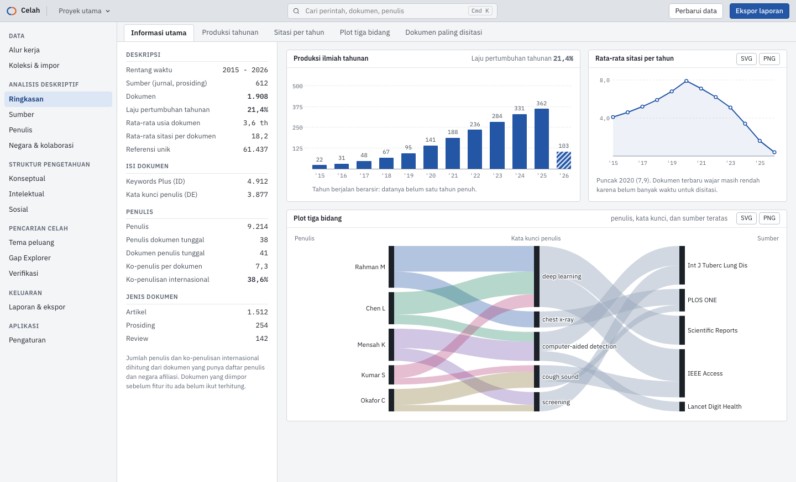
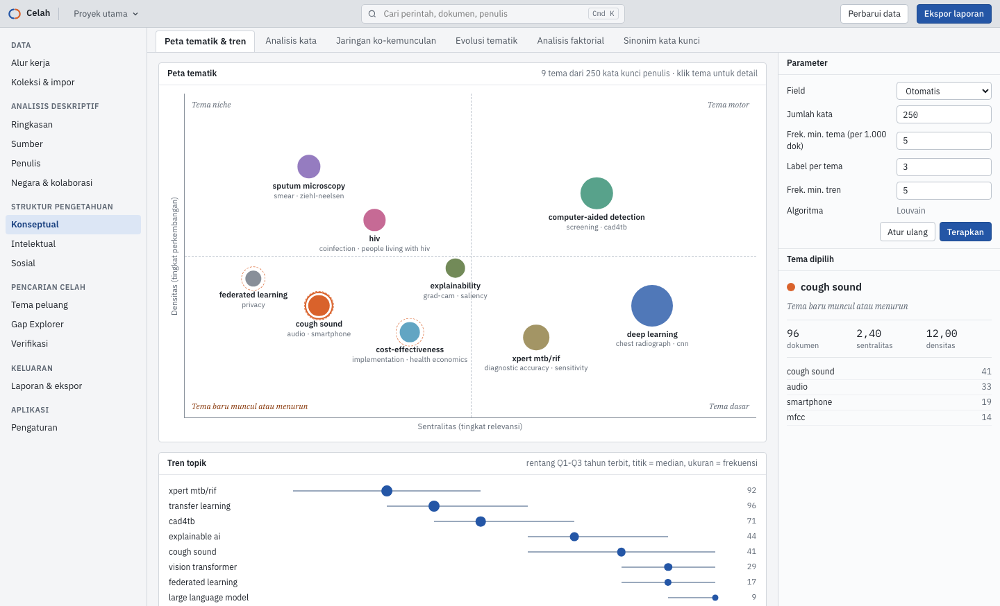
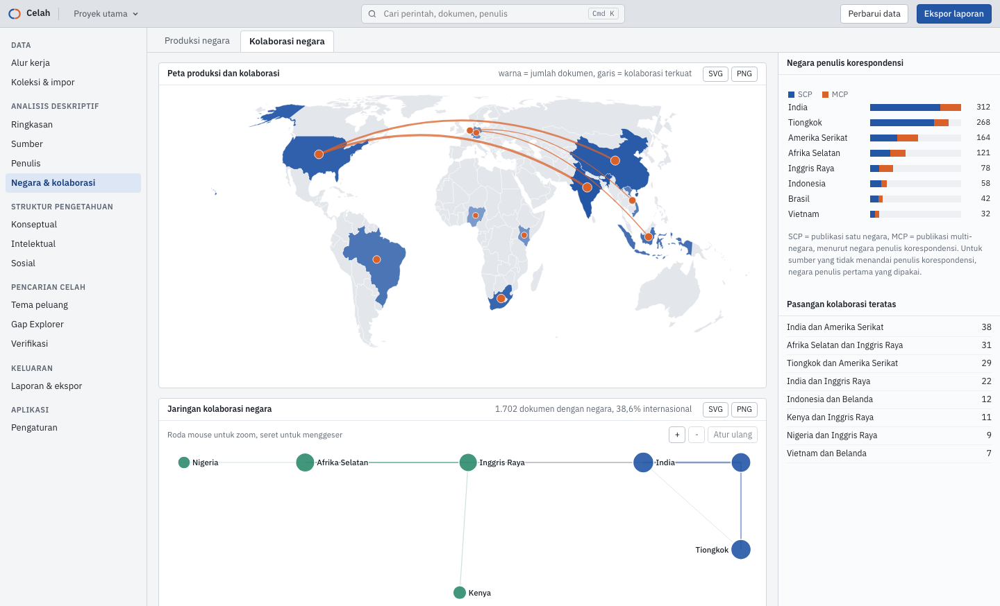
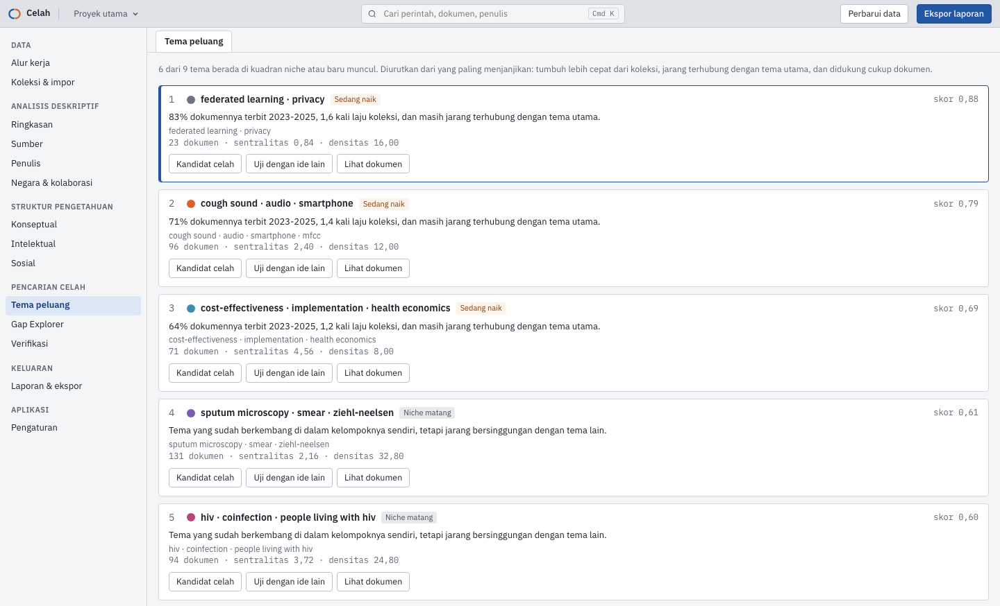
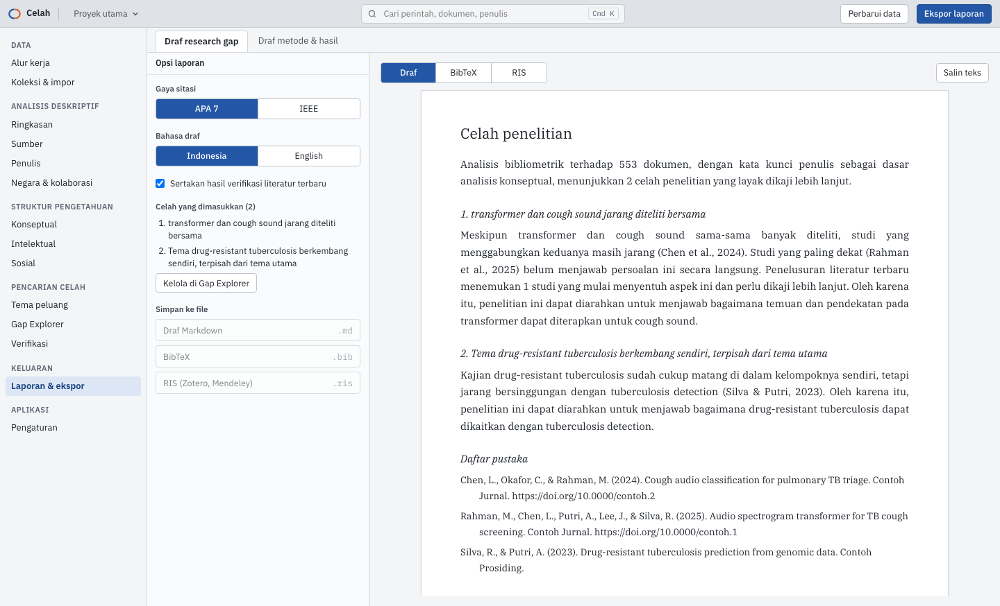

# Celah

Aplikasi desktop untuk analisis bibliometrik dan pencarian celah penelitian (*research gap*) yang didukung
bukti dokumen. Kumpulkan literatur dari OpenAlex, PubMed, Crossref, dan sumber lain, atau impor ekspor
Scopus, Web of Science, PubMed, dan RIS. Petakan bidangnya, lalu tinjau kandidat celah beserta dokumen
pendukungnya sampai menjadi draf bab yang siap disunting. Semua data tersimpan di komputer Anda.

*A desktop app for bibliometric analysis and evidence-backed research gap finding. The interface is
available in Indonesian and English (Settings > Display).*



## Fitur

- **Kumpulkan dan rapikan data**: pencarian ke enam sumber terbuka (OpenAlex, Crossref, Semantic Scholar,
  PubMed, Europe PMC, arXiv), impor file ekspor, penggabungan
  duplikat, sinonim kata kunci, penyatuan nama penulis, pelengkap rujukan dari Crossref, dan kuartil jurnal
  dari SJR.
- **Analisis deskriptif**: produksi tahunan, sitasi, sumber (Bradford), penulis (Lotka), negara dan
  kolaborasi internasional, plot tiga bidang.
- **Struktur pengetahuan**: peta tematik, evolusi tema, analisis faktorial, jaringan ko-kemunculan,
  ko-sitasi, kopling bibliografis, historiograf, dan RPYS.
- **Pencarian celah**: tema peluang, Gap Explorer dengan skor dan bukti dokumen, uji ide celah Anda
  sendiri, dan verifikasi ke literatur terbaru di luar koleksi.
- **Keluaran**: draf research gap dan draf metode & hasil (APA 7 atau IEEE, Indonesia atau English),
  ekspor BibTeX, RIS, CSV, dan gambar grafik.

| Alur kerja | Ringkasan |
| --- | --- |
|  |  |
| **Peta tematik** | **Negara & kolaborasi** |
|  |  |
| **Tema peluang** | **Draf research gap** |
|  |  |

## Pemasangan

Unduh installer dari halaman [Releases](https://github.com/est57/celah-research-gap/releases/latest).
Setelah terpasang, Celah memperbarui dirinya sendiri lewat Pengaturan > Tentang > Periksa pembaruan.

| Sistem | Berkas |
| --- | --- |
| macOS Apple Silicon (M1 dan setelahnya) | `Celah_x.y.z_aarch64.dmg` |
| macOS Intel | `Celah_x.y.z_x64.dmg` |
| Windows 10/11 | `Celah_x.y.z_x64-setup.exe` (atau `.msi`) |
| Linux | `.AppImage`, `.deb`, atau `.rpm` |

Installer belum ditandatangani sertifikat pengembang berbayar, jadi sistem akan memberi peringatan sekali:

- **macOS**: buka `.dmg`, seret Celah ke Applications. Bila muncul "tidak dapat dibuka karena pengembang
  tidak dikenal", buka Pengaturan Sistem > Privasi & Keamanan, lalu klik **Tetap Buka**.
- **Windows**: bila SmartScreen muncul, klik **Info selengkapnya** lalu **Tetap jalankan**.
- **Linux (AppImage)**: jalankan `chmod +x Celah_*.AppImage`, lalu buka berkasnya.

Langkah pertama setelah dibuka: ikuti layar **Alur kerja**. Panduan lengkap ada di
[docs/PANDUAN.md](docs/PANDUAN.md).

## Pengembangan

```bash
npm ci
npm run tauri dev
```

| Perintah | Fungsi |
| --- | --- |
| `npm run dev` | Pratinjau browser dengan data contoh (tanpa backend) |
| `npm run tauri dev` | Aplikasi desktop lengkap |
| `npm run check` | Cek tipe TypeScript |
| `npm test` | Tes logika frontend (Vitest) |
| `npm run test:ui` | Tes tata letak semua halaman di lebar 1440, 1100, 800 (Playwright) |
| `cargo test --manifest-path src-tauri/Cargo.toml` | Tes backend |
| `cargo test --manifest-path src-tauri/Cargo.toml -- --ignored` | Tes dengan API sungguhan dan uji skala |
| `npm run tauri build` | Installer untuk sistem saat ini |
| `node scripts/gen-world.mjs` | Membuat ulang data peta dunia di `src/data/world.json` |
| `node scripts/screenshots.mjs` | Membuat ulang screenshot README (jalankan `npm run dev` lebih dulu) |

Linux butuh `libwebkit2gtk-4.1-dev libappindicator3-dev librsvg2-dev patchelf libdbus-1-dev`.

## Rilis

Workflow `.github/workflows/build.yml` menjalankan pemeriksaan di setiap push dan pull request. Tag `v*`
juga membuat installer macOS (Apple Silicon dan Intel), Windows, dan Linux sebagai draf rilis. Untuk tanda
tangan macOS, isi secret `APPLE_CERTIFICATE`, `APPLE_CERTIFICATE_PASSWORD`, `APPLE_SIGNING_IDENTITY`,
`APPLE_ID`, `APPLE_PASSWORD`, dan `APPLE_TEAM_ID`.

Pembaruan otomatis memakai plugin updater Tauri. Aplikasi membaca `latest.json` dari rilis terbaru di GitHub dan
memeriksa tanda tangan setiap berkas dengan kunci publik di `src-tauri/tauri.conf.json`. Isi secret
`TAURI_SIGNING_PRIVATE_KEY` dengan kunci privat pasangannya (tanpa kata sandi) agar rilis memuat berkas updater.
Kunci privat tidak pernah disimpan di repositori. Rilis harus dipublikasikan (bukan draf) agar terbaca sebagai
rilis terbaru.

## Aturan kode

Lihat [CLAUDE.md](CLAUDE.md): tanpa emoji, file pendek (di bawah 150 baris), SQL berparameter, validasi
semua masukan `invoke()`, HTTP hanya ke API riset yang diizinkan, dan tampilan responsif.

## Lisensi

MIT. Lihat [LICENSE](LICENSE).
